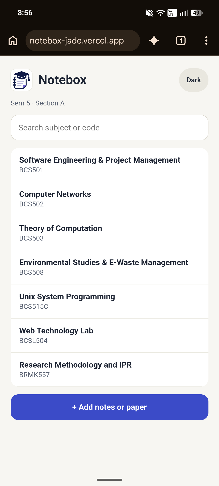
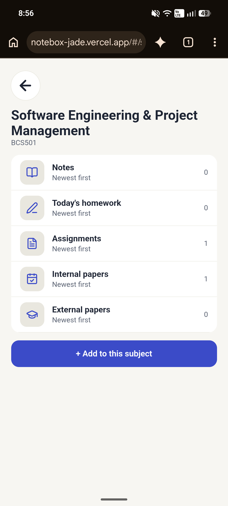
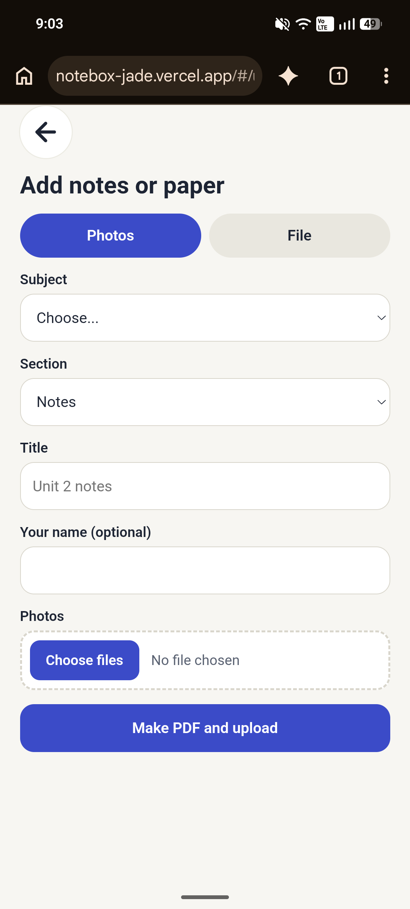
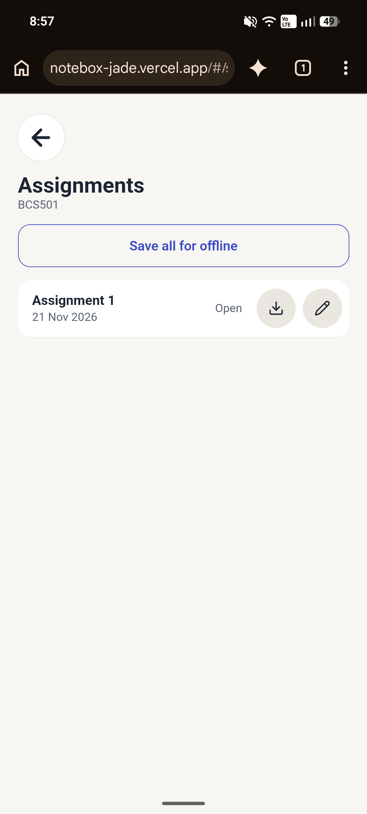

# Notebox

A small web app that gives a college class one shared place for notes, homework, assignments and question papers, instead of many copies spread across WhatsApp groups.

**Live app:** https://notebox-jade.vercel.app

| Home | Subject | Upload | Offline |
|---|---|---|---|
|  |  |  |  |

## The problem

In my class of 60, notes and homework were shared as photos in WhatsApp groups. Three things kept going wrong:

1. The same notes were copied into many groups, so nobody knew which copy was the latest.
2. Photos of pages arrived in the wrong order, so I had to turn them into a PDF by hand every time.
3. During exam week, many classmates had weak mobile signal and couldn't download files when they needed them.

## What it does

- **Subjects with five sections each:** Notes, Today's homework, Assignments, Internal papers and External papers.
- **Photos to one PDF:** pick page photos, reorder them, and the app shrinks them and builds a single ordered PDF on the phone before uploading.
- **File upload:** PDF, Word, PowerPoint, Excel or text files up to a size limit.
- **PDF shrinker:** a button that re-renders a large scanned PDF at lower quality in the browser, so it fits the upload limit. Nothing is sent to a server for this.
- **Save for offline:** save one file or a whole section on the phone, and read it with no signal. The app and its file lists also open offline.
- **Share to WhatsApp:** after an upload, one tap opens WhatsApp with a ready message and link.
- **Edit, move and remove:** fix a wrongly filed document. Removing is a soft delete, so a mistake can be undone from the database.
- **Class code:** only people with the class code can read or upload.
- **Light and dark theme,** installable on a phone's home screen.

## Tech stack

| Part | Choice |
|---|---|
| Frontend | React with Vite, React Router (hash routing) |
| Backend | Supabase (Postgres database, file storage, row-level security) |
| PDF building | `pdf-lib` |
| PDF shrinking | `pdfjs-dist` (renders pages) plus `pdf-lib` |
| Offline | `vite-plugin-pwa` (service worker), Cache Storage, `localStorage` |
| Icons | `lucide-react` |
| Hosting | Vercel |

## How it works

```
Phone or laptop (React app)
  |  reads and writes with the class code sent as a header
  v
Supabase
  - Postgres: subjects, documents, class_settings
  - Storage: "notes" bucket for PDFs and files
  - Row-level security checks the class code on every request
```

- **Upload flow:** photos are compressed and combined into a PDF in the browser, the PDF goes to the storage bucket, and a row describing it is added to the `documents` table.
- **Class code check:** the app stores the code on the device and sends it as an `x-class-code` header. A database function checks it against a table the browser can't read, and the access policies call that function. This means the check is enforced in the database and not only in the page.
- **Offline flow:** a service worker caches the app itself. After every online visit, the full list of files is saved on the phone, so lists work offline. File contents are saved only when the user taps save, and are read back from the browser's cache storage.
- **Soft delete:** removing a file sets a `deleted_at` time. The file stays in storage and can be restored by clearing that value.

## Project structure

```
src/
  components/   BackLink, Brand, ThemeToggle
  lib/          supabase.js, makePdf.js, compressPdf.js, offline.js, docs.js
  pages/        Gate, Home, Subject, Section, Upload, Edit
  App.jsx       class-code gate and routes
  main.jsx      theme setup and service worker registration
public/         icons and manifest
```

## Getting started

You need Node.js (LTS), a free Supabase project, and a code editor.

```bash
git clone https://github.com/gouthami6364/notebox.git
cd notebox
npm install
```

Create `.env.local` in the project root:

```
VITE_SUPABASE_URL=https://your-project-id.supabase.co
VITE_SUPABASE_ANON_KEY=your-publishable-key
```

Use the **publishable** (anon) key only. Never put the secret or `service_role` key in this app or in the repository. `.env.local` is ignored by git.

Then set up the database (below) and run:

```bash
npm run dev
```

To test offline behaviour, use a production build, because the service worker doesn't run in dev mode:

```bash
npm run build
npm run preview
```

### Database setup

Run this in the Supabase SQL Editor. Change `choose-your-code` first.

<details>
<summary>Show SQL</summary>

```sql
create table subjects (
  code text primary key,
  name text not null
);

create table documents (
  id uuid primary key default gen_random_uuid(),
  subject_code text not null references subjects(code),
  section text not null check (section in ('notes','homework','assignment','internal','external')),
  title text not null,
  exam_date date,
  academic_year text,
  session text,
  file_path text not null,
  uploaded_by text,
  created_at timestamptz default now(),
  deleted_at timestamptz
);

create table class_settings (code text primary key);
insert into class_settings (code) values ('choose-your-code');

alter table subjects enable row level security;
alter table documents enable row level security;
alter table class_settings enable row level security;

create or replace function is_member() returns boolean
language sql stable security definer set search_path = public as $$
  select exists (
    select 1 from class_settings
    where code = (current_setting('request.headers', true)::json ->> 'x-class-code')
  );
$$;

create or replace function check_code(c text) returns boolean
language sql stable security definer set search_path = public as $$
  select exists (select 1 from class_settings where code = c);
$$;

grant execute on function is_member() to anon;
grant execute on function check_code(text) to anon;
grant usage on schema public to anon;
grant select on public.subjects to anon;
grant select, insert on public.documents to anon;
grant update (subject_code, section, title, exam_date, academic_year, session, deleted_at)
  on public.documents to anon;

create policy "read subjects" on subjects for select using (true);
create policy "members read documents" on documents for select to anon using (is_member());
create policy "members add documents" on documents for insert to anon with check (is_member());
create policy "members update documents" on documents for update to anon
  using (is_member()) with check (is_member());

create policy "members upload files" on storage.objects
  for insert to anon with check (bucket_id = 'notes' and is_member());
```

Then add your subjects:

```sql
insert into subjects (code, name) values ('CODE1', 'Subject name');
```

</details>

In **Storage**, create a bucket named `notes` and make it public.

### Deploy

Push to GitHub and import the repository in Vercel. Add the two environment variables from `.env.local` in the project's settings before deploying.

## Design decisions

- **A website, not a native app.** About half of my class uses iPhone and half uses Android. A native Android app would have left half of them out, and publishing for iPhone needs a Mac and a paid developer account. An installable web app reaches everyone.
- **WhatsApp share is one tap, not automatic.** WhatsApp doesn't let an app post into an ordinary group chat on its own, and unofficial tools can get accounts banned. The app opens a ready message instead.
- **Offline for weak signal.** Files are compressed before upload, lists are cached after each visit, and files can be saved ahead of exams.
- **Soft delete.** Everyone with the class code can edit and remove files, so removal hides a file and doesn't destroy it.
- **PDF shrinking in the browser.** It avoids uploading an oversized file just to compress it, which matters on weak connections.

## Limitations

- **The class code is a shared secret.** Anyone who has it can read, upload, edit and remove. There are no individual accounts, so the app can't tell who did what.
- **Files are reachable by direct link.** The storage bucket is public, so someone who has a file's exact link can open it without the class code. The links are random, but don't upload anything personal or sensitive.
- **Free plan limits.** Supabase's free tier has caps on storage and monthly downloads, and pauses projects that are inactive for a week. Check the current limits on their pricing page.
- **Offline is partial.** A file opens offline only if it was saved, and new uploads from others appear after the next online visit. Phones can clear saved data when storage is low.
- **Shrunk PDFs lose selectable text,** because each page becomes an image.
- **Word and PowerPoint files** download instead of opening in the browser.
- **No automatic sorting of question papers yet.**

## Roadmap

- Reading the subject code from a photographed question paper (OCR) to suggest the subject, with a confirm step.
- Individual accounts, and limiting edits and removal to the uploader and an admin.
- Push notifications for new uploads.
- A button to save everything for one subject at once.
- Kannada and Hindi interface text.

## Security notes

- Only the publishable key is used in the browser, and `.env.local` is never committed.
- `pdfjs-dist` was upgraded to a patched version after `npm audit` reported a known vulnerability, and scripting and `eval` are turned off when reading PDFs. Run `npm audit` before deploying.
- Access rules live in the database, so hiding a page in the interface isn't the only protection.

## What I learned

- Researching existing tools before building. I started with a storage cleaner idea, found that Files by Google already covered most of it, and changed direction to a problem I see every week in my own class.
- Designing around real constraints: weak signal, mixed phone types, and free-tier limits.
- Putting access control in the database instead of relying on the interface.

## License

Add a license of your choice here, for example MIT.